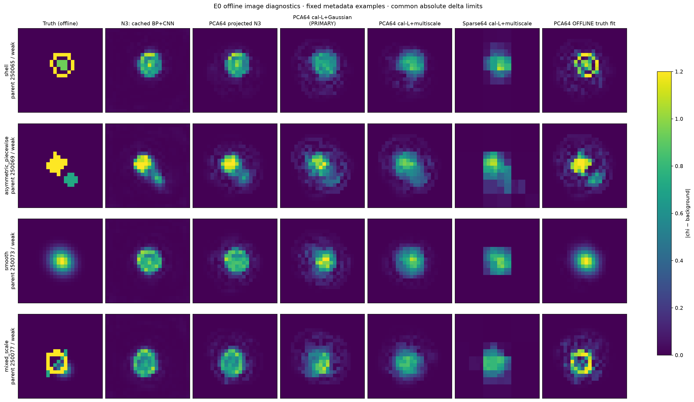
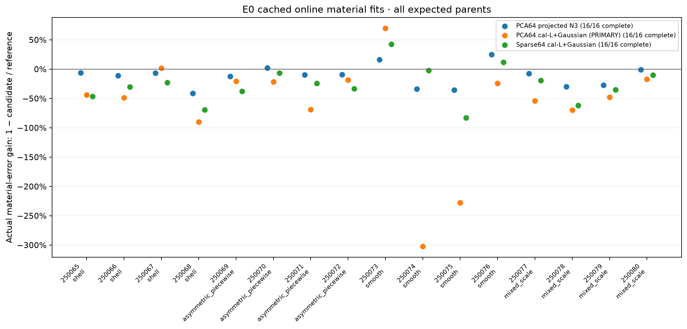
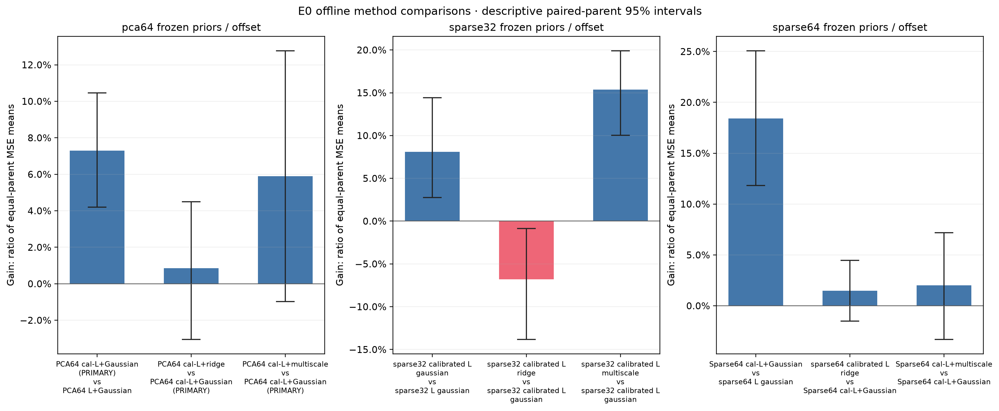
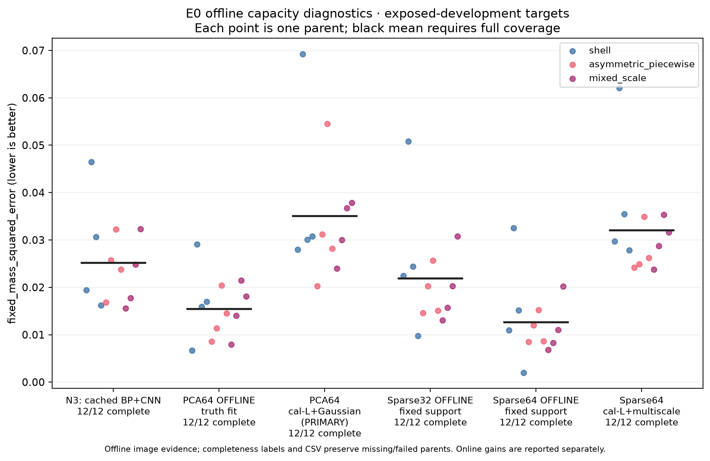
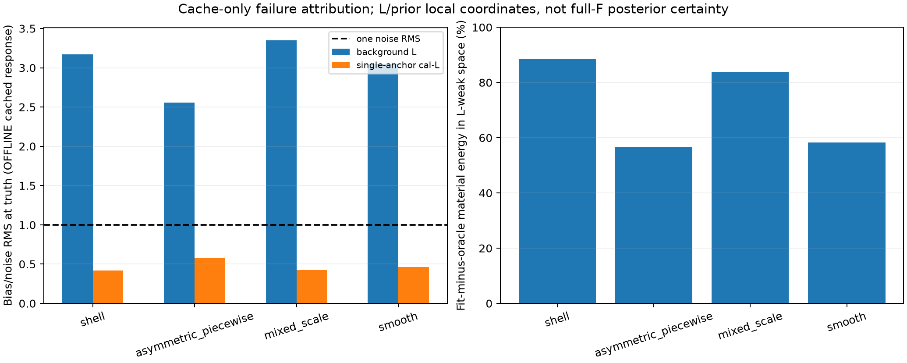
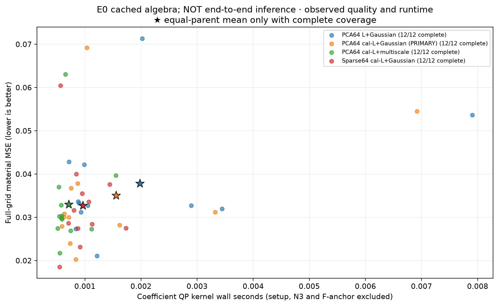

# A32 — 连续材料恢复与 A17 材料风险反馈：执行与科学裁决

2026-10-12。**E0 FAIL；E1及三维验证 NOT_RUN。** 全部32条件已完成，包含16个已暴露 parent。主方法的复杂材料固定平方误差相对 N3 **恶化 39.46%**，没有达到预先固定的改善5%目标。没有支付新的全波状态，也没有用 full F 补救失败。

## 1. 物理问题与已有研究

材料表示能够拟合真值，并不意味着观测能够选出那个材料。A30 已经证明有限 bank 的凸组合、Sparse/PCA连续参数具有离线容量，而原 L-weighted bank 选择失败；它并没有执行连续系数反演。因此 A32 首先补上这个缺口，再判断是否值得研究 A17 的材料风险反馈。

[A17 的原始理论](https://github.com/migodam/a17-maxwell-certified-exchange/blob/df61a1b533682a883cdaf65259b4528c354bd832/closure_final/manuscript/CORE_THEORY.tex)描述同一物理状态下 current Galerkin空间改变如何同时改变材料曲率与残差拉回。[效率后续](https://github.com/migodam/a17-maxwell-certified-exchange/blob/df61a1b533682a883cdaf65259b4528c354bd832/efficiency_followup/GPT_REVIEW_CONTEXT.md)已经显示冻结 GN收益保留不等于最终图像改善或加速。[最新 A30](https://github.com/migodam/a30-maxwell-observable-material-manifold/blob/717d3d26a290248bd2b9aeb55f3d03694b407b84/A30_E0_E1_DECISION.md)是这里的容量依据；其13.12% hull、35.69% Sparse-64、21.91% PCA-64都是离线结果，旧补偿／uniform certificate路线未通过。

A32没有重做理论，也没有把附加物理检查变成成像资格。A31包的旧 DC-MDI主线和128状态计划被本次明确的 E0→条件E1协议取代。

## 2. 数据、材料与信息边界

平台为 **24×24二维标量 TM**、8源、32接收器、512维实测量、1152维全网格实材料坐标，complex128／float64。两个背景为 weak和ring；32条件均为既有 amplitude1.2、20dB观测。TRAIN64与已暴露 development16严格分开；未打开 locked ID/OOD，未生成新标签、未训练网络。

材料 box为 Reχ∈[−0.5,4]、Imχ∈[0,0.5]，cell mass=1/576。逐源[Re32,Im32] packing与sqrt(2)/σ白化得到缓存恒等式核对。既有标签固定复增量相位，本结果不代表任意独立实虚部材料恢复。

主表示是TRAIN-only非中心化 PCA64。Sparse32/64采用A30规则的第一个合法support；没有读取best_start_id、truth-selected支持或oracle系数。T=1.2B，因此实际材料度量M=TᵀWT=1.44I。初值是N3在同类中的box可行投影，未保留类外N3残差。

Gaussian先验由64独立TRAIN系数均值和OAS协方差形成；[OAS来源](https://arxiv.org/abs/0907.4698)是已知协方差估计方法。ridge匹配协方差trace，不能声称其precision强度相同；多尺度先验使用TRAIN Haar层方差的precision pullback。N3用于初值／支持，以及已有F(N3)缓存的同锚偏移校准；未当作独立prior重复乘相同数据。开发truth未参与先验、超参数或方法选择。

在线过程先保存32份预测和完成标记，再允许独立评分器读取truth。缓存F(N3)只用于F(N3)+L(χ)−L(N3)的偏移；不是F(投影N3)，也不是免费冷部署物理。

## 3. 实施与数值验证

实现了真实连续系数的受约束凸二次拟合，解析梯度、可行QR active-set、统一200迭代上限、KKT 1e−8、可行性1e−10；没有jitter、伪逆、像素后clipping或阈值放宽。

32条件×3表示×4拟合=384次在线measurement-conditioned QP；另有96次N3可行投影和96次独立offline固定chart truth-fit。**576/576 QP成功**。记录的最大KKT相对量为1.481e-14；主方法独立重新组装检查最大stationarity残差为6.234e-16，最大raw可行性误差1.943e-16。这排除了当前已执行小凸问题的优化器未收敛解释，不保证材料正确。

50项A32测试通过，覆盖paired实化／Schur、signed Hessian、局部风险恒等式、一次HVP的对偶界、GN-gap与材料risk反例、完整source-field双缺陷、重心变换、数据隔离、box／KKT、统一预算拒绝及parent配对完整性。原A31的22项JSON只是保留的历史证据；缺失的CORE_THEOREM.md和a31_r1_checks.py没有被冒称已运行。

数学接口严格比较J_V→J_[V,C]。ΔJ=YΓ⁻¹N没有被当作对背景J_L的精确修正。active box的更新不冒用无约束paired closure，局部Gaussian风险不冒称非线性后验风险。详见[数学说明](docs/MATHEMATICAL_SCOPE.md)。

## 4. 连续材料恢复结果

先在每parent内平均weak/ring，再等权汇总12复杂parents；smooth单列。门槛是固定平方材料误差之均值比，不是平均parent NRMSE增益。全部失败或缺失都应计入；本次配对完整。

|方法|材料 MSE|相对 N3 的 MSE 改善|Δχ NRMSE|IoU|edge F1|
|---|---:|---:|---:|---:|---:|
|N3：已有 BP+CNN|0.025143|+0.00%|0.6359|0.5712|0.5617|
|PCA64 投影 N3|0.028094|-11.74%|0.6736|0.5319|0.5052|
|PCA64 / L / Gaussian|0.037826|-50.44%|0.7811|0.4689|0.4446|
|PCA64 / calibrated-L / Gaussian（主方法）|0.035064|-39.46%|0.7505|0.4925|0.4463|
|PCA64 / calibrated-L / ridge|0.034763|-38.26%|0.7505|0.4830|0.4398|
|PCA64 / calibrated-L / multiscale|0.032995|-31.23%|0.7312|0.4992|0.4526|
|Sparse32 / calibrated-L / Gaussian|0.049672|-97.56%|0.9017|0.4385|0.4327|
|Sparse64 / calibrated-L / Gaussian|0.032709|-30.09%|0.7276|0.5082|0.4806|
|Sparse64 / calibrated-L / multiscale|0.032054|-27.49%|0.7191|0.5142|0.4676|
|PCA64 固定 chart：OFFLINE truth-fit|0.015418|+38.68%|0.4940|0.6799|0.7202|
|Sparse64 固定在线 support：OFFLINE truth-fit|0.012608|+49.85%|0.4323|0.7357|0.7688|

主方法的2000次parent配对bootstrap区间为 **[-53.63%, -25.20%]**；它仅描述已暴露小样本不确定性，不追加显著性gate。所有复杂家族均恶化：

|家族|独立 parents|主方法相对 N3 的 MSE 改善|PCA64 离线容量改善|
|---|---:|---:|---:|
|shell|4|-40.14%|+39.08%|
|asymmetric_piecewise|4|-36.15%|+44.34%|
|mixed_scale|4|-42.22%|+32.00%|
|smooth|4|-69.54%|+66.42%|

Sparse64的smooth子组有约7–9%的MSE改善，却没有在复杂家族复制；不能用smooth替代主端点。多尺度prior是冻结对照，虽然比Gaussian稍好，仍未超过N3。没有事后切换主方法。

本表offline容量使用**当前同一在线固定support**及固定MSE口径，不能与A30 best-of-eight相对NRMSE数字直接相减。PCA64和Sparse64的容量改善分别为38.68%、49.85% MSE；这些不是在线算法结果。

图示预选250065／250069／250073／250077的weak条件，未挑最好图；统一|Δχ|色标0–1.2，完整数值保留于NPZ。右列明确OFFLINE truth-fit：说明chart有容量，不说明测量已恢复该结构。

此图比较冻结方法彼此的增量；正值不表示优于N3，也不改变主门槛失败。

## 5. 失败机制：已验证什么，仍不能归因什么

**表示限制存在，但不足以解释全部失败。** PCA64投影N3使复杂MSE恶化11.74%，说明强制全局chart损失了N3的一部分结构；同chart truth-fit仍可以改善38.68%。因此“表示内没有更好材料”已被直接反驳。Sparse64的投影损失只有3.33%，其在线Gaussian拟合仍恶化30.09%，也不能仅归因于PCA投影。

**优化器不是已执行凸问题的主瓶颈。** 独立KKT复核通过；truth-fit与在线MAP在相同材料类内指向不同图像。更长地解同一个凸目标不会因此自动接近truth。

**偏移校准确实帮助数据模型，却没有解决材料选择。** 复用原clean labels，在真值材料处、按噪声每分量RMS比较，L模型偏差为3.024倍噪声；single-anchor calibrated-L降至0.474倍。实际噪声白化RMS为0.997。这没有付费新F。cal-L的MSE也比未校准L稍好，却仍明显输给N3。

**弱方向与先验有直接迹象。** 按固定TRAIN prior白化的背景Jacobian谱，64维中平均43.08维的likelihood/prior曲率比低于1。主拟合与同chart oracle之差的76.32%材料能量位于这一背景L弱空间；shell、mixed更集中。该“1”是诊断坐标的比较尺度，不是新gate；也不是full-F posterior uncertainty证书。

oracle的平均TRAIN Mahalanobis平方距离为45.07，MAP为25.73。它们说明当前目标在数据／先验之间的取舍，并不能单独证明prior misspecification的因果比例。这里没有重调prior。

剩余限制必须保留：低于单通道噪声的RMS偏差仍可能具有重要的相干材料方向；没有在新恢复图像处支付full-F，也没有比较full-F与L的局部弱子空间旋转。因此不能由上述结果宣布full-F derivative无价值、材料不可识别、或者A17理论被推翻。数据模型偏差和结构prior影响尚未被完全因果分离。

数字拓扑采用原4连通前景／8连通背景、truth-derived25%支持阈值，仅用于离线评分。主方法的components计数误差3.375，N3为2.667；hole计数均值有个别下降，却同时损失edge／IoU，不能把更光滑图像写成更好拓扑。完整逐条件计数在CSV。

## 6. E1停止与四个最终问题

冻结主方法MSE改善为-39.46%，未达+5%，故**E1 shadow、短轨迹、条件3D全部NOT_RUN**。不存在原生paired材料收益、predicted-versus-realized真实材料风险或同质量加速数据。风险和source-field模块的矩阵核验不能填补它们。

实现范围止于缓存E0、独立诊断和小矩阵数学测试。后续CLI保留gate拒绝入口；因为资格失败，没有继续接线原生E1轨迹驱动。不能把这些NOT_RUN入口当成已经实现并验证的full-Maxwell材料反馈算法。

1. **连续拟合是否利用A30容量？** 当前冻结Gaussian/ridge/multiscale在线实现没有利用复杂结构headroom；同support的离线容量仍存在。
2. **A17是否提供普通material solver没有的收益？** 本实验尚未取得进入原生E1的资格，答案是NOT_ESTABLISHED；没有建立强算法论文的材料优势。
3. **风险判断是否优于GN-gap？** 小矩阵反例证明两种度量不同，接口通过；真实Maxwell更新的预测价值未运行。
4. **反馈是否有同质量成本优势？** 未建立，不能以小矩阵求解速度、零新增state或当前rank宣称加速。

**研究裁决：NO-GO进入当前A17反馈成像pilot。** 更合理的下一步假说是先建立能够保留N3结构信息的measurement-conditioned材料行动，而不是用一个全局Gaussian MAP把它覆盖；若将N3作为conditional estimator，必须明确同一测量的概率依赖，不能再充当独立prior重复likelihood。这个建议尚未实验，不在本任务追加训练、rank、current bank或新物理。

## 7. 成本、实现失败与复现

新增真实full-wave状态 **0/64**，新LU **0**，新LU RHS **0**，GPU占用 **0秒**，训练更新 **0**。实际背景／F(N3)缓存读入、矩阵应用、prior生成、QP、评分、图表和失败都有CPU记录。E0在线批次包含32条件及全部预登记对照，wall **2.995秒**；这是缓存批处理计算，**不是N3+full-anchor的部署推理时间**。

系数QP的kernel计时与原始测量到图像的完整耗时分开。N3已缓存，F(N3)来自历史paid state；首次部署取得它们的成本未在这里重新测量。没有共同质量命中，也没有实际冷／warm端到端提速结论。

CPU按每个实际job的wall／process CPU较大者记账，报告生成时记录 **36.283/1800秒**；后续报告与发布费用以COST_LEDGER及publication记录为准。交互式少量读文件及外部模型推理未被这些host-job receipt完全覆盖，不把该数字当全部工作总耗时；预算远未接近上限。worker失败的NumPy／Matplotlib导入、解释器路径，以及一项过严roundoff测试断言均保留；数值solver／科学门槛没有因此改变。最终整合50测试通过。

材料与模型收益失败和实现失败分开记录。没有hash／SHA256检查，没有traceable备份或额外native测试campaign。A17/A30原代码、结果及NO-GO均未改写。

执行入口、依赖和公共输入下载见[README](README.md)。原始指标见[E0 CSV](results/a32/offline/E0_CASE_METRICS.csv)、[逐parent表](results/a32/offline/tables/E0_PARENT_METRICS.csv)、[失败归因](results/a32/offline/FAILURE_ATTRIBUTION.csv)。最终状态与完整计费分别见[FINAL_DECISION](results/a32/FINAL_DECISION.json)、[COST_LEDGER](results/a32/COST_LEDGER.jsonl)、[FAILURE_LEDGER](results/a32/FAILURE_LEDGER.jsonl)。大数组另放Release；在线预测与offline truth-fit分目录。

## 8. 证据层级

|层级|实际状态|
|---|---|
|A17／A31已有理论|读取、复用；没有因实验失败改写|
|A32矩阵、访问边界和QP测试|50项通过；不当作材料优势|
|已有真实Maxwell数据上的在线材料恢复|完整32条件，主方法FAIL|
|同chart offline capacity|完整32条件；truth拟合，不是在线算法|
|新原生Maxwell反馈／三维验证|NOT_RUN，新增state=0|
|盲测、NN、后续E2|NOT_RUN／未授权扩展|
|网页发布|VERIFIED_PUBLIC；发布成功不改变科学NO-GO|

公开阅读入口：[GitHub仓库](https://github.com/migodam/a32-material-risk-directed-feedback)、[匿名raw主报告](https://raw.githubusercontent.com/migodam/a32-material-risk-directed-feedback/main/A32_E0_E1_DECISION.md)、[实际数组Release](https://github.com/migodam/a32-material-risk-directed-feedback/releases/tag/a32-e0-v0.1.0)。[网页核验记录](publication/PUBLICATION.json)记录当时的commit、公开URL和资产长度；后续费用／发布元数据提交不改变科学数组。最终交付commit另作匿名核验。
